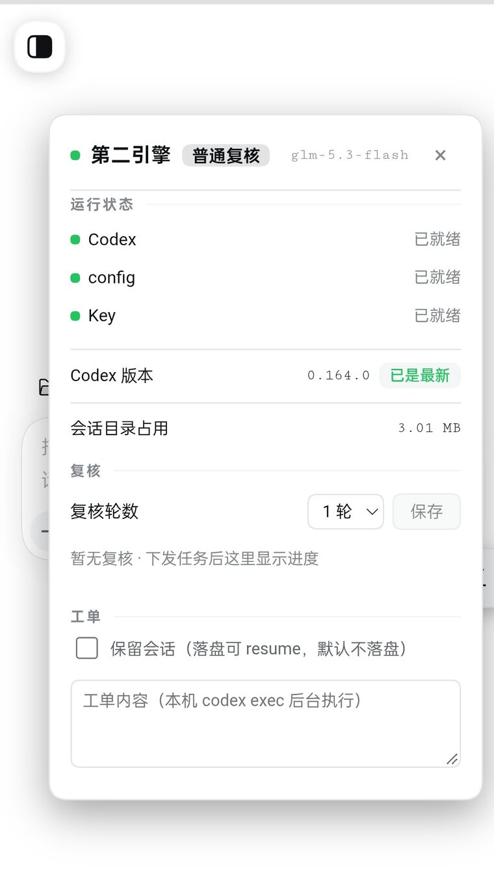
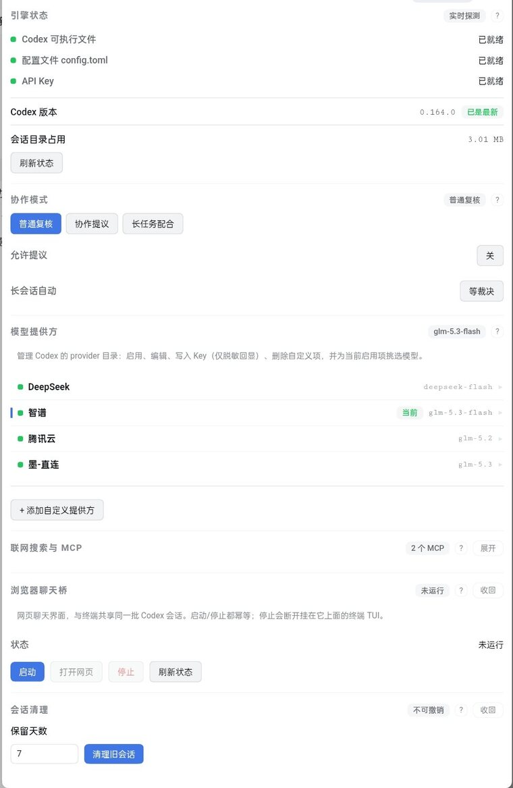
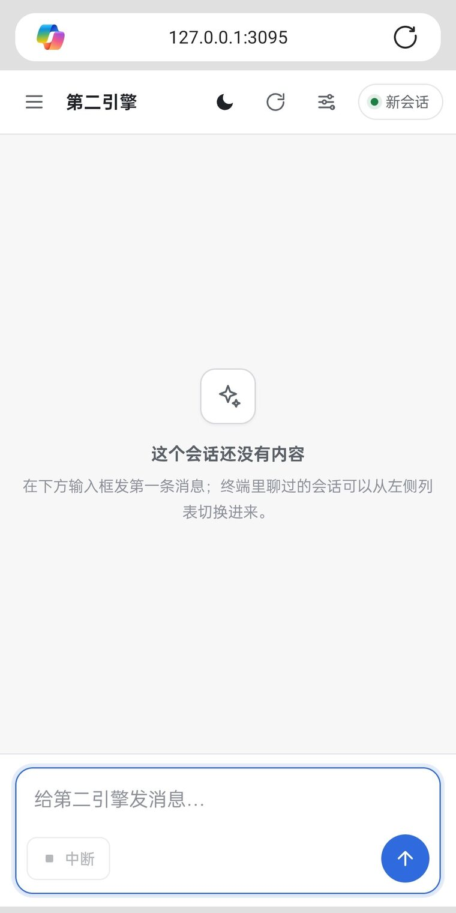
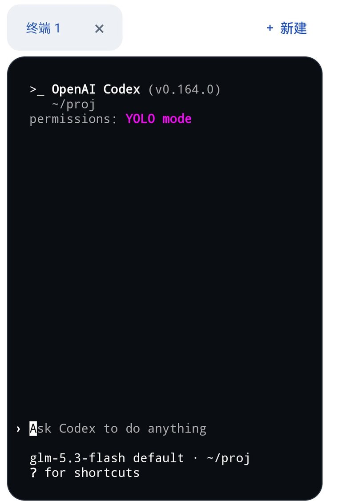
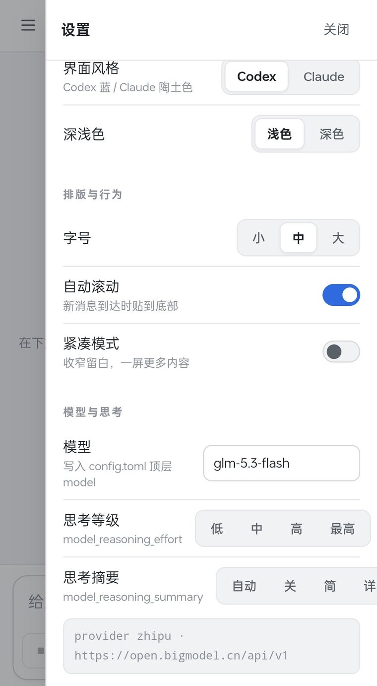

# dsh-second-engine

> 🚀 **你的 AI 也能拥有自己的 AI**：装一个插件、再装个 223MB 的 Codex CLI，你的 DeepSeek Harness 里就多了一位 7×24 待命的**第二引擎**——主 AI 干累了可以「让 Codex 试试」，写完代码自动互审挑刺，卡住还会主动喊救命。一个手机，两颗大脑，你只管裁决。
>
> **v3.5.0 起，两颗大脑开始「商量着干活」**：三档协作模式 —— **普通复核**（默认，派单即完）· **协作提议**（要它自己表态愿不愿意接、接哪部分）· **长任务配合**（不派工单，主 AI 直接开长会话边干边聊）。档位在悬浮球里切，切完对下一次派单生效。

| 平台 | 状态 |
|---|---|
| **Android（DSHA）** | ✅ 实测全功能（免 ROOT 免 Termux：[DSHA 下载](https://github.com/qiannianhuanxiang/DSHA) · [项目主页](https://github.com/DSH-APP/DSHA)）|
| **Windows / macOS（DSH 桌面壳）** | ⚠️ 理论兼容未实测（插件为纯 Node；需换装 x86_64 版 Codex 二进制；App 通知能力视宿主而定）。桌面壳参考：[desk-harness](https://github.com/llyyhh0487/desk-harness) / [deepseekharness-desktop](https://github.com/honghuachen/deepseekharness-desktop) |

**占用账单（安卓实测）**：Codex 本体 223MB + 数据 33MB + 插件依赖 0.3MB ≈ **256MB**，换一个独立执行、互审、救场的第二 Agent。

> 把 OpenAI Codex CLI 接入 DeepSeek Harness（DSH），作为与主 AI 并行的**第二引擎**。

在同一台 Android 设备的 DSHA 容器（Ubuntu / proroot）里，主 AI（DSH）与 Codex 双引擎并存：主 AI 编排与审核，Codex 独立复核、并行下探、提供异构第二意见——三者各司其职：**Codex 生产 · 主 AI 编排审核 · 用户裁决**。

## 功能

- **设置面板**（DSH 设置 → 第二引擎）
  - 引擎状态灯：Codex 二进制 / config.toml / API Key（纯本地探测，不上报）
  - **模型提供方管理**：预设 DeepSeek / 智谱（端点均经实测），支持添加任意自定义提供方（Provider ID / 名称 / API 地址 / 协议 / 模型），可编辑、填 Key、切换激活
  - **模型获取与选择**：一键从提供方拉取可用模型列表，下拉切换
  - **模型与思考**：`/api/config` 写 `config.toml` 顶层 `model` / `model_reasoning_effort` / `model_reasoning_summary` / `sandbox_mode` / `approval_policy` / `web_search`（键白名单 + 写前备份 + 原子替换）
  - **插件自身版本提示**：`/api/plugin-version` 读自身 `package.json` 与 GitHub releases 比对（成功缓存 1h / 失败 10min）；**无更新时界面完全不出现**，有更新才在设置卡与浮动球提示，只提示不自动装
  - 会话清理：按保留天数清理 Codex 会话文件
- **浮动球**：会话界面常驻半露小球，点开即达状态摘要与工单入口
- **异步工单**：面板直接下发任务（后台 `codex exec`），完成经 App 通知提醒，支持取消
- **双向互审**：把产出交给 Codex 做多轮批判性复核（轮数上限 / 零新增提前收敛 / 分歧打包上交用户 / 任意时刻熔断），轮数在面板设置
- **卡点求助协议**：插件自动向 `~/.codex/AGENTS.md` 写入协作协议——Codex 连续失败或绕圈时主动调 `/api/consult` 提交卡点并通知，主 AI 带建议接手
- **本地翻译桥**（实验性）：`responses → chat completions` 协议转换，让仅有 chat 协议的提供方（部分中转 / 自建网关）也能接入 Codex
- **知识层**：随包分发 SKILL.md，主 AI 自动获得唤起与协作流程（工单下发、diff 审查、异常速查）

## 环境单例 —— 安卓上的 PC 式双引擎

Android 的沙箱模型把环境切碎了：每个 App 各自下载依赖、各部署一遍。本插件逆着这个模型，把 DSHA 容器变成**双引擎共用的环境单例**：

- **Codex 不自带依赖**：工单里跑的每条命令直接使用容器现成的 Python / Node / 工具链 / 词库（55 个沉淀脚本即取即用），插件本体仅 0.3MB——它只是环境的调度器，不是又一轮部署；
- **双引擎互为备份**：主 AI 装插件/写配置出问题时，Codex 有完整 shell 可以接手排查修复；反过来 Codex 卡住走 consult 协议喊救命，主 AI 带建议回来——谁都能救谁。

## 双引擎分工

| 角色 | 职责 |
|---|---|
| Codex（第二引擎） | 生产：exec 小粒度工单、独立复核、并行下探 |
| DSH 主 AI | 编排：拆任务、布置环境、审 diff、落主区 |
| 用户 | 裁决：分歧点上交，最终取舍由人 |

## 协作看板（dual-board，v1.4）

长任务协作走文件看板。**脚本与协议随插件**：`tools/dual-board/`（`board.sh` / `board_tool.py` / `dispatch.sh` / `PROTOCOL.md`，2026-09-30 收编、路径自定位）；**运行数据**默认仍在 `/root/proj/dual-board/`，可用 `DUAL_BOARD_DIR` 覆盖（Codex 侧由 `/root/proj/AGENTS.md` 自动注入，无需人工提醒）：

- **写板唯一入口 `board.sh`**（v1.2 起）：CAS + O_EXCL 锁 + 原子写 + 状态机 + JSONL 归档 + `doctor` 体检都在工具里，**手改 `board.json` 视为破坏协议**。退出码即语义（3 CAS 冲突 / 4 依赖未完成 / 5 状态非法 / 6 锁超时 / 7 scope 越界 / 8 无 git 降级）。
- **派单一律走 `dispatch.sh`**：自动注入收件箱未读段、附派单纪律、在派单**前**记基线 commit 与工作区脏快照到 `.dispatch/<task id>.base`；交付后用 `board.sh scope-check <id>` 机械校验写范围越界。
- **看板**：`board.json` —— 状态 `pending / in_progress / blocked / completed / abandoned`（**无 reopen**，completed 不可复改）；工单三字段：`task`（用户原话，不可变）/ `context`（主 AI 解读）/ `frame`（质疑前提是分内事，由工具自动写入）。
- **收件箱**：`inbox-codex.md` / `inbox-lead.md` 双向留言（经 `board.sh inbox-append`），已读标注 + 按月 JSONL 转档（`archive/`）；交付必含四段：交付 / **异议位** / 下一步建议 / 自验。
- **可开工引导 `board.sh ready`**（v1.4 起）：只读列出「前置已满足」的下一步，与 `claim` 的依赖门互补（claim 是拒绝、ready 是引导；空态退出码 0）。
- **过程级检索 `trace_search.py`**（v1.4 起）：`list` / `search` / `get` 三档，在历史会话 rollout 里按关键词找**过程证据**（不只找结论），`--exclude-session` 可排除自己。
- **双通道**：短任务走 `/api/task`（ephemeral 零记忆，保互审独立性）；长任务 `codex exec resume <thread_id>` 成员会话（一条链绑一个任务，看板 `session` 字段登记，收工归档）。
- **可视化**：浏览器聊天桥（3095）的会话列表抽屉 = 成员会话切换，终端/网页/主 AI 三方同链。
- ⚠️ **已知限制**：脏工作区下 scope 校验会漏报（协议 §十一）；给 Codex 的 workdir 尽量干净。

## 前置要求

- DeepSeek Harness（新版 App + Web）
- [OpenAI Codex CLI](https://github.com/openai/codex/releases) **≥ 0.164.0** —— 本版实测基线就是 `0.164.0`；更低版本（如 `0.155.x`）没有系统验证过，`exec` / `app-server` 的协议面可能对不上

### 安装 Codex CLI（Android proot / aarch64 Linux）

到 [Releases 页](https://github.com/openai/codex/releases) 下载 **aarch64-unknown-linux-musl** 资产（musl 静态二进制在 proot 下可直接运行），解压后放进 PATH：

```bash
curl -LO https://github.com/openai/codex/releases/latest/download/<资产文件名>
tar -xzf <资产文件名> && install -m755 codex /usr/local/bin/codex
codex --version   # 验证
```

> GitHub 直连慢/失败：在下载 URL 前加镜像前缀（如 `https://ghproxy.net/https://github.com/...`）。资产文件名以 Releases 页实际列表为准。

### 用 GPT 系模型：还要装 `codex-code-mode-host`（必读）

Codex 自 0.144 起把命令执行拆到独立 sidecar。用 `gpt-5.6-*` / `gpt-6-*` / `codex-auto-review` 这类 **`code_mode_only`** 模型时，缺了它模型能正常回话、但**工具一个都执行不了**（报 `failed to spawn code-mode host ... host executable was not found`）；内置目录里只有 `gpt-5.5` 不受影响，降版本也躲不开。

取与 CLI **同版本**的 sidecar，解压后放到 **codex 主二进制同目录**（无需进 PATH）：

```bash
VER=$(codex --version | grep -oE '[0-9]+\.[0-9]+\.[0-9]+' | head -1)
curl -fL -o /tmp/cmh.tar.gz \
  "https://ghproxy.net/https://github.com/openai/codex/releases/download/rust-v${VER}/codex-code-mode-host-aarch64-unknown-linux-musl.tar.gz"
tar -xzf /tmp/cmh.tar.gz -C /tmp
install -m 0755 /tmp/codex-code-mode-host-* \
  "$(dirname "$(readlink -f "$(command -v codex)")")/codex-code-mode-host"
```

> 备选通道：npmmirror 的 `@openai/codex@<版本>-linux-arm64` 平台包（`vendor/<arch>/bin/` 内含它）。
> 验收判据：让它「建一个文件并运行」——回复像不像不算数，看文件是否真落盘。回复正确但目录为空＝host 没装上。

## 长什么样

<p align="center">
  
  
  <br>
  <sub>左：<b>悬浮球</b> —— 三档协作模式一点即切，底部是 Codex 版本与会话占用两行 kv，有新版才亮徽标。
  <br>右：<b>设置页</b> —— 引擎状态、协作模式、四家模型提供方、联网搜索与 MCP、浏览器聊天桥。</sub>
</p>

<p align="center">
  
  
  <br>
  <sub>左：<b>浏览器聊天桥</b> —— 手机浏览器里直接和 Codex 对话，与终端共享同一批会话。
  <br>右：<b>终端 TUI</b> —— 原生 Codex，YOLO mode 全功能。</sub>
</p>

<p align="center">
  
  <br>
  <sub><b>界面风格</b>（Codex 蓝 / Claude 陶土色）· 字号 · 模型与思考等级</sub>
</p>

## 安装

两种方式二选一。**不要跳过依赖安装**：插件用 `link:` 注册时，宿主不会替你装插件自己的依赖；缺依赖的表现是「装完重启，设置页没有第二引擎」，而且没有报错。

### 方式 A：tgz 安装（推荐，无需改配置文件）

1. 下载 Releases 里的 `dsh-second-engine-3.6.2.tgz`；
2. 打开 DSH App 的插件管理页，安装时粘贴 tgz 的 HTTPS 直链，或容器内绝对路径（如 `/root/Downloads/dsh-second-engine-3.6.2.tgz`）；
3. 重启 Web，设置页出现「第二引擎」即成功。

tgz 由 pnpm 解析，`dependencies` 会自动装上，不需要再跑 `npm install`。

### 方式 B：源码安装（需要终端）

```bash
# 1. 解压源码到实体目录（目录与路径随你，下文以 /root/dsha-second-engine 为例）
cd /root/dsha-second-engine
npm install --omit=dev          # ★ 必做：link: 不会替你装依赖，跳过这步插件会静默不加载

# 2. 注册进 profile
cd ~/.dsh/profiles/web
#   package.json: dependencies 加 "dsh-second-engine": "link:/root/dsha-second-engine"
#   dsh.profile.bundles 数组加 "dsh-second-engine"
pnpm install

# 3. 重启 Web，设置页出现「第二引擎」分区即成功
```

### 安装后：收录知识层 skill（强烈建议）

插件包里的 `skills/second-engine/`（`SKILL.md` + `Codex功能表.md`）是**给主 AI 读的操作手册**——派单模板、施工五要点、诊断清单、异常速查、协作模式全在里面。它**不会自动出现在 DSH 的 skill 目录**，需要手动放一次：

```bash
# ① 找已安装的包目录（tgz / 源码安装位置不同，两处都找一下）
PKG=$(find "$HOME/.dsh/plugin-src" "$HOME/.dsh/profiles" -maxdepth 5 -type d -name dsh-second-engine 2>/dev/null | head -1)
# ② 拷进 DSH 的 skill 目录
mkdir -p "$HOME/.dsh/skills"
cp -r "$PKG/skills/second-engine" "$HOME/.dsh/skills/"
# ③ 校验：应看到 SKILL.md 与 Codex功能表.md
ls "$HOME/.dsh/skills/second-engine/"
```

装好后，你说「用 Codex / 第二引擎 / 第二意见 / 让 Codex 试试」时，主 AI 会自动加载这套流程，而不是临场即兴发挥。

不装也能用插件（面板、工单、互审都正常），只是主 AI 少了这份手册，**派单质量与踩坑规避会明显变差**。

升级插件后 `skills/` 可能更新，**重跑第 ② 步覆盖即可**（`cp -r` 会合并覆盖同名文件）。

## 配置

1. 设置 → 第二引擎 → 模型提供方 → 选择预设（DeepSeek / 智谱）或添加自定义；
2. 填入 API Key（保存于 `~/.codex/keyring.json`，0600 权限，界面仅脱敏回显）；
3. 「获取模型列表」→ 下拉选择模型 → 启用；
4. 终端快速启动：`codex-env`（自动注入激活提供方的 Key 并进入 Codex TUI）；只想取浏览器聊天桥网址用 `codex-env -u`。

### 路径与环境变量（换机器必读）

`/root` 本身是 DSHA 容器的固定根，**不用改**。真正要确认的是「你的 Codex 工作区在哪」——
下表是按本机默认值整理的，个别变量你的环境可能不同：

| 变量 | 默认值 | 说明 |
|---|---|---|
| `SECOND_ENGINE_WORKDIR` | `/root/proj` | 异步工单的默认工作目录。这是**作者本机的 Codex 工作区**，你的机器上可能没有 ⇒ 设成自己的项目目录，或先 `mkdir -p /root/proj` |
| `DSH_HOME` | `/root/.dsh` | DSH 数据目录，决定 `.bridge_token` 的落点。DSHA 默认就是它，一般无需改 |
| `DSH_BRIDGE_TOKEN_PATH` | `$DSH_HOME/.bridge_token` | 通知令牌文件完整路径，一般不用动 |
| `DSH_WEB_URL` | 宿主注入 | 插件路由基址，**不要写死端口** |
| `SECOND_ENGINE_EXEC_MODE` | `exec` | 工单执行模式（`exec` / `appserver`） |

> 出现「工单卡住 / 找不到目录 / 通知发不出」时，先对照上表看这两个路径是否落在真实存在的目录。

### 终端使用（TUI）

| 动作 | 方式 |
|---|---|
| **启动** | 终端页敲 `codex-env`（自动注入激活提供方的 Key → 进入 /root/proj → 拉起 TUI）|
| **退出** | `Ctrl+D` 或输入 `/quit` |
| **取桥网址** | `codex-env -u`（只打印网址、不进 TUI、不注入 Key）；或 `cat <桥目录>/.url`（桥目录＝运行实例目录，默认 `bridge/web/`） |
| **网页聊天桥** | 浏览器打开取到的网址（`127.0.0.1:3095`，自带 token 鉴权，等于密码别外传）；终端 TUI 与网页**共享同一批会话** |
| 换模型 | TUI 内 `/model`（或回设置面板「获取模型列表」选）|
| 看改动 | `/diff`；会话恢复 `codex resume` |
| 中文输入 | App 终端输入法受限时，在 Web 输入框写好复制粘贴进去 |

### 预设提供方（端点实测）

| 提供方 | Base URL | 协议 | 说明 |
|---|---|---|---|
| DeepSeek | `https://api.deepseek.com/v1` | responses | 直连 |
| 智谱 | `https://open.bigmodel.cn/api/v1` | responses | GLM Coding 端点 |

### 会话与磁盘（谁落盘，落哪里）

| 来源 | 会话记录 |
|---|---|
| 面板/浮动球下发工单 | **默认不落盘**（ephemeral，审计靠 git diff）；勾选「保留会话」才落盘 |
| 终端 TUI / `codex exec`（命令行） | 落盘 `~/.codex/sessions/年/月/日/`（约 33KB/次，可 `codex resume`）|
| 共同 | `~/.codex/*.sqlite` 状态库（官方管理，插件不清理）|

服务层每 6 小时自动兜底清理（保留 7 天 / 总量超 200MB 从最旧删）；面板「会话清理」可手动按天清理。

## API 入口（唤起 Codex 的正确地址）

插件路由挂在 **Web 服务**上，地址取环境变量 **`$DSH_WEB_URL`**（DSH 启动时注入，随 Web 端口变化，**不要写死端口**）：

```bash
W="$DSH_WEB_URL"                                            # 例: http://127.0.0.1:<Web端口>

curl -s "$W/second-engine/api/status"                       # 自检: {"ok":true,"codexBinary":true,...}

curl -s -X POST "$W/second-engine/api/task" \
     -H 'Content-Type: application/json' \
     -d '{"prompt":"<自包含工单>","workdir":"/root/proj","ephemeral":true}'   # → {"id":"..."} 立即返回
```

- ⚠️ **不要用 App 设备桥的端口**（`/app/*`：读屏/点按/截屏/通知那套）去拼插件路由：那不是插件路由，未知路径会被当 shell 命令执行，返回
  `{"result":"[NO_CMD]"}` —— 看着像「插件 API 不存在」，实际是敲错门（2026-09-27 实测）。
- **工单是异步的**：`POST /api/task` 拿到 `{id}` 就可以走人，**完成经 App 通知提醒**；等结果用
  `tools/wait-task.sh <id> [轮询间隔=5] [总超时=600]` 放进**后台 job**（完成通知自动唤醒等待者，退出码 `0=done / 2=失败 / 3=不存在 / 4=接口不可用 / 124=超时`），
  **不要自己写 `sleep`+`curl` 轮询**。

## 支持能力一览（v3.6.2）

| 能力 | 状态 | 说明 |
|---|---|---|
| **复核 `blocked` 硬档** | ✅ 3.6.0 | 模型在 `verdict` 里给 `block`/`blocked`、或任一 issue 的 `severity` 属阻断级（`blocker`/`critical`），即归一成 `blocked` 并**立即终止、不再跑后续轮**；输出块首行换 `[REVIEW_BLOCKED]`，面板显示「⛔ 阻断 · 禁止上线」。用于「涉及钱 / 数据丢失 / 安全漏洞」这类不该等下一轮的问题 |
| **独立来源可见性** | ✅ 3.6.0 | 复核结果新增只读字段 `independentSources`（当前恒为 `1`）与 `quorumNote`：让「这次 converged 只有一个独立来源」这件事可见。**只做可见性，不参与收敛判定**——双引擎下若「不足就不许收敛」，等于永远无法收敛 |
| **路由自描述 `GET /api/_meta`** | ✅ 3.6.0 | 24 条路由的 method/path/desc 由注册表自动生成，取代 SKILL 里手抄的路由表（手抄必腐） |
| **复核处境块**（`buildReviewContext`） | ✅ 3.5.0 | 复核时随请求注入处境（对话与事实链：产物路径 / 报错原文 / 已试路径 / 当前卡点 / 轮数），Codex 不必猜上下文。**只当行为提示，不是安全边界** —— 真边界在 cwd 强制校验与权限白名单 |
| **逐条 `verified` 标注** | ✅ 3.5.0 | 每条 issue 必须带 `verified` 布尔：经实际运行或读文件核实过为 `true`，只凭文本推测为 `false`。**仅作信息字段，不参与收敛判定** —— 自报值不可信，把收敛权交给它会诱导模型批量标 `unverified` 来快速收敛 |
| **复核 cwd 强制校验** | ✅ 3.5.0 | 与工单对齐：接受 `body.workdir`，**目录不存在直接 400**，不再回落到敏感默认目录。这条是处境块能可靠工作的前提（否则处境块可能把模型引到错误的 `~/.codex`） |
| **per-run 处境取代全局静态 context** | ✅ 3.5.0 | 不往 `~/.codex/AGENTS.md` 写「插件版本 / workdir / 执行模式」这类全局静态 context，改为每次复核随请求注入。理由：全局静态 context 在切换工作区或换 provider 后容易变成误导 |
| **协作模式三档**（collab） | ✅ 3.5.0 | 普通复核 / 协作提议 / 长任务配合 + 自定义第四组合。两位各自独立：`voice`（允许它主动提议）/ `longtask`（分阶段任务直接开长会话）；优先级 环境变量 > `~/.dsh/second-engine-collab.txt` > 默认。切 `voice=on` 立即写 `~/.codex/AGENTS.md` 的 voice 段、切回即删（文件 0600）。悬浮球面板与设置页都能切 |
| 插件自身版本提示 | ✅ 3.1.2 | `/api/plugin-version` 读自身 `package.json` 与 GitHub releases 比对（成功缓存 1h / 失败 10min）；**无更新时界面完全不出现**，有更新才在设置卡徽标与浮动球红点提示，只提示不自动装 |
| **首 token 看门狗（180s）** | ✅ 3.0.0 | app-server 模式迟迟不回第一个事件时不再无限挂起——超时即判失败并报错，工单不会静默卡死 |
| **终态方法集合** | ✅ 3.0.0 | 过滤迟到的旧 turn 事件，避免上一轮结果覆盖当前工单 |
| **上下文占用率多版本兜底** | ✅ 3.0.0 | `contextUsageRatio` 在多种 app-server 版本上都能算出（取不到时降级，不报错） |
| **会话内切模型** | ✅ 3.0.0 | `thread/settings/update`：不重启即可在会话里换模型 |
| 配置保留段（切提供方不丢） | ✅ v1.2.1 修复 | 重写 `config.toml` 时改用**黑名单**：只排除模板自有的 `[model_providers.*]` 与 `[memories]`，其余段一律原样保留；此前白名单式重写会把 `[features]` / `[tui]` / `[projects.*]` 静默抹掉且不报错 |
| 浮动球交互 | ✅ v1.2 | 指针拖动（鼠标 / 触屏 / 触控笔通用）+ 松手吸附最近左右边缘 + 纵向位置记忆；面板内显示 Codex 版本与新版本提示 |
| scope-check 脏工作区 | ✅ v1.2 修复 | 派单时记 `write_scopes` 的 sha256 快照，交付后比对——「派单前就脏、之后又被改」不再漏报；无 git 时降级为哈希校验 |
| Codex 功能表 | ✅ v1.2 | `skills/second-engine/Codex功能表.md` 随包分发 |
| 提供方切换 / 工单 / 双向互审 | ✅ | DeepSeek / 智谱直连，chat 协议上游经翻译桥自动挂接；切换不丢用户配置（sandbox、MCP） |
| AGENTS.md 联网搜索三档降级 | ✅ v2 | 原生 web_search 优先 → Exa MCP 备胎 → 全无则凭已有知识完成任务并标注「未经联网核实」；v1 用户自动原位升级 |
| tools/t-tool.sh | ✅ 实测 | tmux 交互窗口：屏幕快照、哨兵式等待、`run` 退出码回传、owner 防串台；**依赖 tmux**（`apt install tmux`） |
| tools/wait-task.sh | ✅ 实测 | 工单完成阻塞等待，退出码语义完整；配后台 job 使用，完成通知自动唤醒等待者 |
| Exa MCP（可选外挂） | ⚠️ 限额 | `https://mcp.exa.ai/mcp` 匿名可用但有隐性限额（偶发 rate limit，重试即可）；正式用去 exa.ai 注册免费 key |
| 面板「联网搜索与 MCP」分区 | ✅ v0.3.4 | web_search 开关（live↔disabled）与 MCP 增删直接落 config.toml；八项验收 + 切提供方持久性 + 智谱端到端原生搜索实测通过 |
| 工单审批策略 | ✅ v0.3.4 修复 | `approval_policy="never"` 固定写入 config；此前字段丢失曾致写工作副本外目录的工单无限挂起 |
| 面板交互 | ✅ v1.0 | 分区折叠（右上角「展开/收回」带框文字按钮 + 标题行整行可点）、抽屉限高 78vh 内滚、**工单列表固定最近 5 条**（面板高度恒定，头部 × 不被挤掉）——手机实测确认 |

## 版本记录（择要）

> **3.1.2 → 3.5.0 是跳号发布**：这一轮动的是**协作机制本身** —— 三档协同、主 AI 侧派单契约、版本提示自动熄灭。不是挤牙膏式修补，按换代走。

| 版本 | 关键点 |
|---|---|
| **3.6.2** | **补第二批「端口 / 注释」缺陷 + 固化冒烟**。① `tools/wait-task.sh`（连环境变量兜底都没有）与 `tools/dual-board/dispatch.sh` 的 Web 地址默认写死 `127.0.0.1:3080`，动态端口下派单/等待直接连不通 → 新增 `tools/web-base.sh`，优先级 `SECOND_ENGINE_BASE_URL` > `DSH_WEB_URL` > 运行中宿主 `--port` > 3080。② 行尾注释保留改**引号感知**（新 `bridge/web/toml-comment.mjs`）：值含 ` # ` 时不再从引号内部切开，`#` 前无空格的尾注也能保留。③ 新增 `tools/smoke.sh`：干净环境冒烟（语法 / 端口解析 / wait-task 联调 / 看板全链路 / dispatch 草稿 / install dry-run / 注释单测 / 三处落点对齐）。④ 版本记录计数口径统一：3.6.1 实为 **14 处**（5+2+2+1+3+1）。 |
| **3.6.1** | **修「干净环境一跑就崩」的 14 处（提交说明的「9 处」只数了前三个文件）**（3.6.0 包里它们在新装用户第一次运行时全部踩中；作者机因目录早已手建从未触发）：`install.sh` 按旧布局找路径等 5 处 · `board_tool.py` 不建数据目录 + **12 个子命令无一能建板** · `dispatch.sh` 收件箱缺失即报错 + 用数据目录找随包脚本 · `package.json` 的 `files` 漏 `wait-task.sh`/`t-tool.sh` · 3 个注入函数补 `mkdirSync(CODEX_DIR)`（没装 Codex 时装插件，`AGENTS.md` 会被静默吞掉且不再补）· 网页桥 `updateConfigToml` 保留行尾注释。**验收**：`DUAL_BOARD_DIR=$(mktemp -d)` → `board.sh new` → `dispatch.sh` 双 exit 0。 |
| **3.6.0** | **债务清算 + 实现优化**。修三处**不报错**的静默失效：① 卡点求助地址写死 3080（新版 DSH 改动态端口后一直连不通，只靠文本兜底）→ 改从宿主 `--port` 解析；② `~/.codex/AGENTS.md` 的 v2/board 段「标记存在就跳过」⇒ 老用户永远拿不到新内容 → 补结束标记 + 摘除重写 + 三级边界（末命中则告警不动手），`v1→v2` 不再静默截断；③ `rounds[].verdict` 与终止判据口径不一致。补两处**写了但从没跑到**的清理：`.live` 被 200 MB 阈值挡在后面（10-17 起未执行）→ 从阈值摘出；Codex 日志库按时间清 + 碎片回收（`node:sqlite`，五道安全闸）。优化：复核**首轮**提示词补三条硬要求（此前纪律只装在第 2 轮后，而 90% 复核只跑 1 轮）· 复核新增 `blocked` 硬档（识别即终止）· 只读 `independentSources`/`quorumNote`（不参与收敛判定）· 写入统一原子化 · `config.toml` 备份轮转留 5 份 · 新增 `GET /api/_meta` 路由自描述。 |
| **3.5.0** | **协作模式三档落地**（普通复核 / 协作提议 / 长任务配合 + custom；`voice` 切档即写/删 `~/.codex/AGENTS.md` 段，`longtask` 只影响主 AI 派单）· 悬浮球加档位下拉 · 球面板版本行改「Codex 版本 / 会话目录占用」两行 kv + 与设置页同款「已是最新」徽标 · **修「升级完红点常亮」**：有新版提示由挂载查一次改为 30s 轮询，且无新版时自动熄灭（旧版只有点亮分支，升级完必须整页刷新才熄）· 主 AI 侧新增「派单前先读档位」流程（插件无推送通道，靠 `/api/status` 主动查）· SKILL 不再记版本号，版本与开关态统一归 `Codex功能表.md` |
| **3.1.2** | 插件自身版本提示（`/api/plugin-version`，默认完全静默）· 面板「模型与思考」`/api/config`（键白名单 + 写前备份 + 原子替换）· 设置页改分区制（说明收进「?」、provider 主行只留名称/徽标/模型、会话清理折起）· 悬浮球面板重排（标题行状态点+模型名、版本与占用并一行、空态去框）· 面板高度跟随 `visualViewport`（键盘弹出不再慢半拍） |
| **3.1.1** | 文档补全：安装分「tgz / 源码」两种方式并标明 link: 必装依赖 · 用 GPT 系模型需另装 `codex-code-mode-host`（含镜像下载与「文件真落盘」验收判据） |
| **3.1.0** | exec 工单过程流 `.live` 跑完即删（不再积压磁盘）· `cleanup` 覆盖 `.live`（并跳过运行中的任务）· dual-board 用法段回灌 · SKILL 增「会话落盘路径与读法」 |
| **3.0.0** | 首 token 看门狗 180s · 终态方法集合（防迟到旧 turn）· `contextUsageRatio` 多版本兜底 · `thread/settings/update` 会话内切模型 |
| v2.6 | dual-board **v1.4**（`ready` 引导 + `trace_search.py` 过程级检索）· 面板滚动条修复 · Codex 侧 dual-board 用法写入全局 `~/.codex/AGENTS.md` |
| v2.5 | 编排层口径 · 翻译桥对账 tick · 互审硬预算 · `/providers/update` 支持 `wireApi` |
| v1.2.1 | 配置保留段改用黑名单（切提供方不再丢 `[features]` / `[tui]` / `[projects.*]`） |

## 已知限制

- **`~/.codex/AGENTS.md` 的注入只在插件启动时执行一次**：装插件时若还没装 Codex CLI（`~/.codex` 不存在），三个注入函数现在会各自先 `mkdirSync(CODEX_DIR, { recursive: true })` 再写，**所以目录缺失本身不再导致失败**（2026-10-26 修；旧版走到 `atomicWriteFileSync` 时抛 ENOENT，被外层 `catch` 静默吞掉且之后不重跑，只能等重启）。**仍然存在的边界**：若 `$HOME` 本身不可写（权限/SELinux 等），注入仍会跳过 —— 看 `GET /api/status` 的 `lastErrors` 里有没有 `agents-protocol`；有的话改权限后**重启一次 Web** 即可补上（`ensure*` 幂等，内容一致时零写入，不会重复叠加）。
- **控制面无鉴权（本机威胁模型，已评估接受）**：`/second-engine/api/*` 只绑 loopback、不校验 token。本机任意进程可调 `POST /providers/update` 把 `baseUrl` 改成自己的地址，再触发 `/task` 或 `/review`，使插件把已存的 provider key 以 `Authorization: Bearer` 发向该地址（completions 模式经本地桥转发）。**这是本机威胁模型下的真实链路，不是远程漏洞**：需要本机代码执行或本机 HTTP 调用能力、且 active provider 已存非空 key。本项目按「单机、不暴露公网」定位接受此风险、不修。若将来要部署在多用户 / 共享机器环境，应优先修 —— 最小改法：`baseUrl` 变更时清空该 provider 的 `apiKey`（地址一变 key 失效，攻击者拿到地址也没 key）。
- **沙箱**：proot 环境无 Landlock / bubblewrap，Codex 需 `danger-full-access` 运行——安全防线在流程层（工作副本隔离 + diff 审查 + git 仲裁），**不要把主工作区直接交给 Codex**；
- **翻译桥**：实验性；内部以非流式请求上游、以流式事件回放，长任务首包延迟等于整段生成时间；
- **工单记录**：内存态，重启 Web 即清空；
- **完成提醒**：经 App 通知提醒用户回 Web 唤起主 AI 验收（DSH 暂无会话主动注入 API）；
- **t-tool run 前提**：目标会话须停在 shell 提示符；pane 正跑前台程序时哨兵等不到，表现为 TIMEOUT（会话不损，等程序结束即可）；命令须写单行；
- **t-tool wait 基线语义**：匹配的是全屏（含旧输出），"等命令跑完"一律用 `run`；需要"只匹配新增输出"时传基线行数（第 5 参）；
- **DeepSeek 无联网搜索**：官方 Responses API 不执行 `web_search`（文档明示禁用）——搜索走 Exa 备胎或主 AI 代查；
- **完成通知节流**：App 通知 30 秒节流，连续快速完成的任务可能合并提醒；
- **插件 API 无鉴权**：`/second-engine/api/*` 仅绑定 127.0.0.1（外网不可及），但本机任意 App 均可无认证调用——个人设备低风险，接入外部 agent 前将统一加 token（bridge_token 同款机制）。

## 执行模式

**工单**支持两种执行模式，切换不需要重启；**复核恒走 `exec`** —— 复核轮次短、`exec` 即默认，所以没有做 appserver 分支。本文件早前版本写作「工单与复核都支持两种」，与实现不符，以代码为准（`execMode()` 全文件仅工单分支引用）：

| 模式 | 机制 | 能力 |
|---|---|---|
| **exec**（默认） | `codex exec` 一次性子进程 + `-o` 文件 | 与旧版完全一致，零风险 |
| **appserver** | `codex app-server` JSON-RPC 长连接 | **流式进度**（`GET /api/task?id=` 的 `progress`，最近 20 条归一化事件）+ **真打断**（`/api/task/cancel` 先发 `turn/interrupt`，65ms 级结束）；输出仍落 `-o` 文件，看门狗判据不变 |

```sh
echo appserver > ~/.dsh/second-engine-mode.txt   # 切 app-server 模式
echo exec      > ~/.dsh/second-engine-mode.txt   # 切回 exec
```

优先级：环境变量 `SECOND_ENGINE_EXEC_MODE` > 上述模式文件 > 默认 `exec`。
验收脚本：`bash <DSH 脚本目录>/se-appserver-verify.sh`（流式进度 / 打断 / exec 回归三条判据）。

**实时可见性（怎么判断"到底行动了没"）**：
- **模型清单**：`POST /api/models {id}` 对智谱会**并集**两个端点（`/api/v1`（Codex 专用，只列 3 个）+ `/api/coding/paas/v4`（全量）），响应里的 `sources` 字段回显实际来源。实测两端点共用同一把 key，且 `/api/v1/responses` 支持全部 glm 模型（2026-09-28）。
- **exec 模式**：`GET /api/task?id=` 看 `liveBytes`（过程流字节数，持续增长即在动）；过程流保留在 `<outPath>.live`（最终结果仍以 `-o` 文件为准）。
- **appserver 模式**：除 `liveBytes` 外还有 `progress` 数组（归一化事件，最近 20 条，可见 reasoning / 文本增量 / 工具调用 / 用量）。
协议依据：事件→归一化字段映射取自 app-server 生成的 JSON Schema（作者的映射笔记不随包分发）。

## 架构

```
dsh-second-engine/
├── skills/second-engine/SKILL.md   # 知识层：主 AI 的操作流程
├── src/index.js                    # 服务层：路由 / 提供方 / 工单 / 桥
├── src/bridge.js                   # 翻译桥：responses ↔ chat
├── lib/client.js                   # 界面层：设置面板 + 浮动球
└── cordis.patch.yml                # bundle 收录声明
```

## License

MIT
